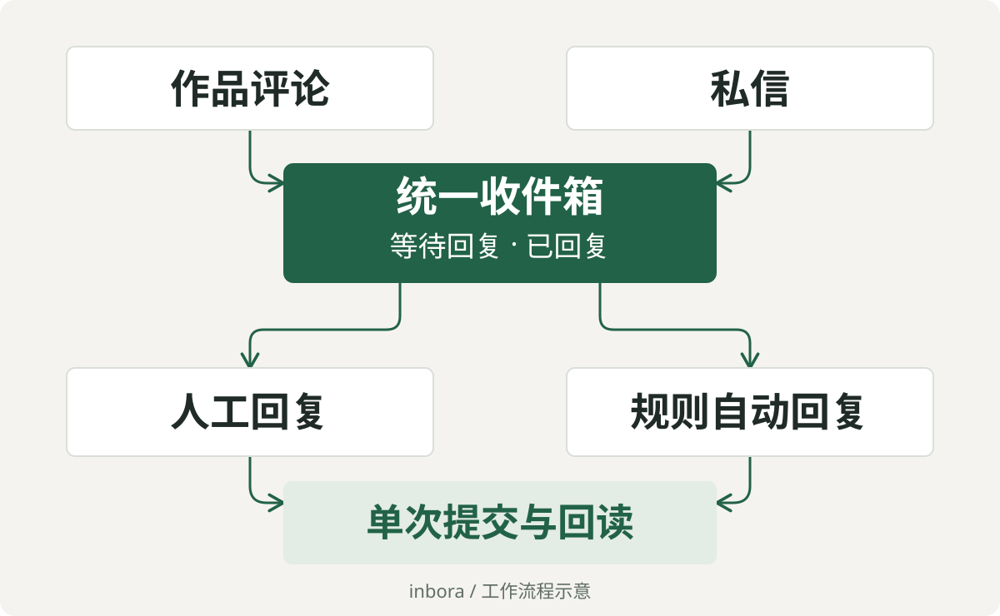

# inbora

**把抖音作品评论和私信放进一个本地收件箱。**

面向国内媒体账号运营的 Windows 桌面工作台，后续将逐步扩展到多个国内媒体平台。当前从抖音单账号起步：集中查看消息、直接人工回复，也可以在明确的账号、通道、规则和额度范围内启用 AI 自动回复。

[开始开发](#开始开发) · [日常使用](#日常使用) · [操作与恢复](docs/AUTOMATION-OPERATIONS.md) · [模型约定](docs/MODEL-CONTRACT.md)

<p align="center">
  
</p>

## 一个收件箱，两种回复方式

- **集中收取**：按会话查看私信，按作品与父评论查看评论。后台保存收取进度，重启后继续补查停机期间的新消息。
- **人工处理**：输入后点一次“发送”，后台完成保存、目标核验、排队提交和结果回读。人工回复无需模型 Key。
- **按规则自动回复**：为准确账号和通道保存策略，设置回复要求、屏蔽词、时段及额度，再用“自动回复：开／关”控制日常运行。
- **保留处理记录**：草稿、发送意图、回执和累计用量保存在本机。无法确认送达的消息保留原因，后台有界核验，避免重复发送。

关闭自动回复后，账号在线、双通道收取和人工回复继续运行；关闭状态在重启后保留。全局急停用于故障处理，会停止采集、模型和发送调度，须显式检查恢复。

## 日常使用

1. **连接已有运行目录**，沿用专属浏览器 Profile 和已保存状态。普通后台浏览器以无头、静音方式运行；需要登录或处理平台验证时由本人接管。
2. **收取并处理消息**，在收件箱查看私信与作品评论；需要手动更新时使用“同步收件箱”。打开准确会话或评论，输入回复并发送。
3. **按需启用 AI**，从左侧“AI 与设置”配置模型，在“后台收取与持续授权”保存准确范围和规则。自动回复默认关闭，保存有效策略后再开启。

“生成 AI 建议”提供可编辑的候选回复，也可使用已保存策略内的模型许可。图片、表情和分享内容的展示资格与模型资格分别核验；预览不可用时显示原因，不让模型猜正文。

模型 Key 默认只在后端内存中保留，也可明确选择 Windows 当前用户 DPAPI 安全保存。浏览器 Profile、数据库、消息和原始证据均留在本机私有运行目录。

详细操作、草稿保护及异常处理见[操作与恢复说明](docs/AUTOMATION-OPERATIONS.md)。

## 开始开发

当前版本为 **0.3.5 开发版**，技术栈为 Tauri v2、React、TypeScript、Node.js、Playwright 和 SQLite。

### 环境

| 项目 | 要求或当前状态 |
| --- | --- |
| 系统 | 当前实测 Windows 10 专业版 x64，Build 19045；Windows 11 待专项验证 |
| Node.js | `>=24.22.1 <25` 或 `>=26.13.0 <27` |
| pnpm | `11.25.0` |
| 浏览器 | Microsoft Edge，使用独立 Profile |
| 原生开发 | Rust、MSVC C++ 工具链、Windows SDK、WebView2 |

```powershell
git clone https://github.com/lwx25799/inbora.git
Set-Location inbora
pnpm install --frozen-lockfile
pnpm typecheck
pnpm test
pnpm inbora --help
```

首次成功应能看到 CLI 帮助并通过类型检查与单元测试。以上命令不连接真实账号、不调用模型，也不发送消息。仓库当前为私有，克隆需要访问权限。

准备好原生工具链后启动桌面开发模式：

```powershell
pnpm desktop:dev
```

仅查看前端可用 `pnpm desktop:dev:web`；该入口不启动原生客户端及其业务内核。前端支持热更新，Node 源码修改按需安全重载后端，原生层变化才重新编译相应部分。

新检出不包含真实账号的运行目录或页面映射。首次真实使用需要本人登录、完成准确页面校准并设置授权；合成测试页面不能替代真实映射。已有运行目录应直接连接，避免重新初始化。维护者本机另有根目录启动入口，其路径与依赖见操作说明。

### 验证命令

| 命令 | 检查范围 |
| --- | --- |
| `pnpm typecheck` | Node 内核与桌面前端类型 |
| `pnpm test` | 单元测试 |
| `pnpm test:integration` | 持久化、服务合同及源码运行链 |
| `pnpm test:e2e` | 本地合成页面的浏览器与界面回归 |
| `pnpm test:built` | 构建后普通 Node 的浏览器夹具链 |
| `pnpm check:source-size` | 代码文件不超过 800 个物理行 |
| `pnpm check:privacy` | 暂存区与 Git 历史中的敏感路径和凭据特征 |

E2E 会启动浏览器，但使用合成数据。真实账号测试、模型调用和外发须在明确授权范围内单独验收；开发期间沿用现有开发模式，只有用户明确要求时才构建安装包。

## 工作原理

```text
Tauri / React 桌面界面与 CLI
              ↓
      共享 Node 业务服务
       ↙             ↘
SQLite 状态与审计    账号级串行队列
                         ↓
              独立 Edge Profile
              评论 Page / 私信 Page
```

同一账号只有一个 Profile 持有者，浏览器操作按账号串行，发送并发固定为一。人工回复与规则自动回复共用发送协调器：发送前绑定准确账号、原消息、目标和全文，先持久化意图，再单次提交并回读。

重启与重连恢复连接、进度和权威状态，已提交或结果未知的消息不自动重发。网页中已有人工输入时保留人稿；遇到身份变化、平台验证或目标不唯一时停止对应动作。

### 为什么使用 Playwright，而不是直接调用平台接口？

本项目当前使用普通抖音个人号，没有可申请的官方评论、私信收发接口，因此通过 Playwright 操作本人登录后的网页，完成收取与回复。

当前选择 Playwright，主要基于三个实际需要：

- **复用本人网页会话**：登录状态留在专属 Edge Profile，由本人处理扫码和验证码，网页通过正常流程发起请求，无需向第三方 Cookie 签名服务提交登录资料。
- **核对实际操作对象**：读取准确会话或父评论、可见正文和编辑器状态，保护网页中已有的人稿；发送前再次核对目标及全文，再操作绑定的网页控件。
- **把提交与结果对应起来**：结合页面回读和正常网页请求的业务回执，核对原生消息 ID、发送方和全文，支撑单次提交、未知结果不重发的处理方式。

网页内部接口与官方开放接口分别看待。直接调用前者会增加非公开请求格式及鉴权逻辑的维护成本，当前实现不主动构造或重放私有发送请求。同时，页面自动化也会[监听正常页面产生的网络响应](https://playwright.dev/docs/network#network-events)，在已校准范围内与可见内容交叉核验，用于读取字段和确认回执。

这个选择需要承担常驻浏览器的 CPU、内存开销，以及页面定位、轮询和加载等待带来的延迟；页面结构变化时还须维护映射与校准。后续扩展其他国内媒体平台时，会逐个平台核对可申请的官方接口、账号权限和通道覆盖，再选择适合的接入方式，并分别验收收取、发送和回执能力。

## 当前边界

- **首个平台、单账号**：当前已实现抖音单账号、本地操作员的作品评论与私信工作台。多个国内媒体平台属于后续扩展方向，多账号运营不在当前迭代范围。
- **开发版结论有范围**：已有 Windows 10 本机开发版的单账号双通道 PoC 验收记录；它不代表完整历史测试矩阵、Windows 11、安装包或正式产品上线均已通过。
- **网页能力依赖校准**：收取通过平台正常页面完成，轮询不等于实时推送，也不承诺读取平台尚未向本人送达的内容。页面变化或缺少准确证据时保留阻断原因。
- **媒体能力分别判断**：受限预览可展示已核验图片、表情或分享信息，当前不据此承诺媒体 AI 理解与自动回复。

## 文档与来源

- [操作与恢复](docs/AUTOMATION-OPERATIONS.md)：日常配置、开发重载、停止与恢复。
- [模型约定](docs/MODEL-CONTRACT.md)：模型配置、上下文、用量和失败处理。
- [上游来源与复用记录](UPSTREAM.md)：固定来源、适配方式和许可证记录。
- [复用与诊断说明](docs/UPSTREAM-REUSE-DIAGNOSTICS.md)：响应分类、运行诊断及维护边界。

界面设计探索保存在 [UI 效果图合集](Inbora_UI_效果图合集/README.md)，其中均为概念图，不能作为当前功能截图或验收证据。真实账号的页面映射、私人消息与原始验收证据不随仓库分发。
